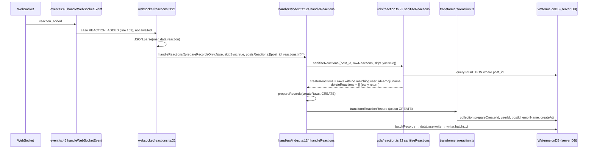
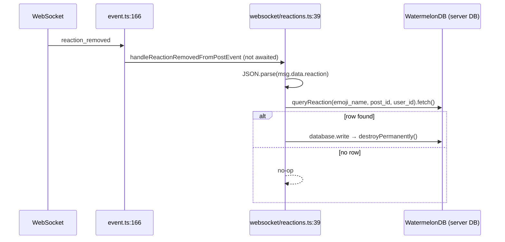

**Short answer:** `reaction_added` goes through the operator's generic `handleReactions` pipeline with `skipSync: true`, which creates a row only if none exists for that user and emoji. `reaction_removed` shares only the switch dispatch. It then bypasses the operator entirely and hard-deletes the row directly.

## Added path

1. `handleWebSocketEvent` (`app/actions/websocket/event.ts:163`) routes `reaction_added` to `handleReactionAddedToPostEvent`. The call is not awaited.
2. `app/actions/websocket/reactions.ts:21` parses `msg.data.reaction` as a JSON string and calls `operator.handleReactions` with `prepareRecordsOnly: false`, `skipSync: true`, and a one-element `postsReactions`. Any exception is swallowed by an empty `catch`.
3. `handleReactions` (`app/database/operator/server_data_operator/handlers/index.ts:124`) calls `sanitizeReactions`. That function (`app/database/operator/utils/reaction.ts:22`) loads every reaction on that post and keys them by `userId-emojiName`. The incoming reaction goes into `createReactions` only if no existing row matches. Because `skipSync` is true, it returns before computing `deleteReactions`.
4. `prepareRecords` (`base_data_operator/index.ts:134`) runs `transformReactionRecord` with `action: CREATE`. `prepareBaseRecord` (`transformers/index.ts:20`) then calls `prepareCreate`, which sets the server `id`, `userId`, `postId`, `emojiName` and `createAt`.
5. Since `prepareRecordsOnly` is false, `batchRecords` (`base_data_operator/index.ts:191`) runs `writer.batch(...)` inside `database.write`. The row is persisted to the server's WatermelonDB.

**Note:** an existing row is never updated. If the user and emoji already match, the reaction is skipped entirely, so a changed `create_at` would not be written.

## Removed path

It shares only the dispatch switch. At `reactions.ts:39` it diverges: no `handleReactions`, no `sanitizeReactions`, no transformer, no `batchRecords`. It runs `destroyPermanently()` inside its own `database.write`, which is an immediate hard delete. The `skipSync` flag does not apply because the operator is never called.

## Flags that change what gets written

| Flag | Where | Effect |
|---|---|---|
| `skipSync: true` | Added event, `websocket/reactions.ts:28` | `sanitizeReactions` returns before computing deletions. Without it, the one-reaction payload would be treated as the full set for the post and every other reaction would be deleted. The full-set diff belongs to the post-level sync in `handlers/post.ts`. |
| `prepareRecordsOnly` | `handlers/index.ts:162` | If true, returns the models without writing. The local `addReaction` action (`app/actions/remote/reactions.ts:65`) uses this so it can batch the reaction together with the recent-emoji record. The websocket path uses `false`, so it writes immediately. |
| `!skipSync` on deletes | `handlers/index.ts:156` | Deletion of stale rows happens only when this is true. This is the only place reactions are deleted through the operator. |

## Echo of local actions

When you react yourself, `addReaction` writes the row, then the server echoes `reaction_added`. The echo finds the existing user and emoji row and writes nothing. For `reaction_removed`, `removeReaction` has already deleted the row, so the echo finds nothing and is a no-op.