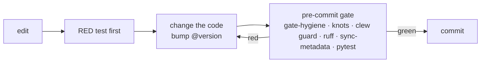

# clew — for contributors

What a person changing clew needs, apart from what a person using it needs (that is
[OVERVIEW.md](OVERVIEW.md)). The contributor contract — the gate, the `@version` rule, "absence
is not emptiness", the seven places a new index layer touches — is [AGENTS.md](../AGENTS.md).



## Development setup

```bash
python3 -m venv .venv
.venv/bin/pip install -e .[dev]   # pipeline + the doxygen gate + dev tooling
sudo apt install doxygen          # external binary (plantuml optional)
.venv/bin/pre-commit install      # the commit-time gate — not optional
```

That last line is listed because this repository reached 1.1.0 without it: nothing gated a commit,
and every green in its history was a human remembering to run one. The `gate-hygiene` hook now
refuses to report success in a checkout where it is missing.

[AGENTS.md](../AGENTS.md) is the contributor contract — the gate, the `@version` rule on doxygen
blocks, "absence is not emptiness", and the seven places a new index layer has to touch.

## Layout

| Path | What |
|---|---|
| `clew/` | The pipeline (`python -m clew`) |
| `clew/query/` | The stable query API the MCP server is a view over |
| `clew/guard/` | The doxygen gate (`clew guard`, formerly doxygen-guard); tests in `tests/guard/` |
| `tests/` | `.venv/bin/python -m pytest tests/ -q` (add `--integration` for the tier that builds real repos) |
| `acceptance/DESIGN.md` | The schema and grading routine for the instrument being rebuilt |
| `acceptance/operational/` | Build and refresh cost, and judge variance — measured beside the matrix, never inside it |

## Dogfooding

clew runs its own gate: `.venv/bin/pre-commit run --all-files` → ruff (lint +
format), the doxygen gate (`@brief`/`@version`/`@return` presence on the shipped
package, run from this tree as `python -m clew guard`), and the full test suite. Its own
catalog lives in `requirements.yaml`.
