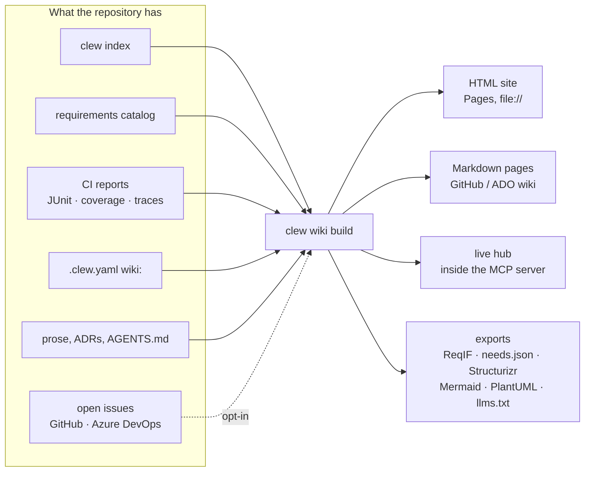
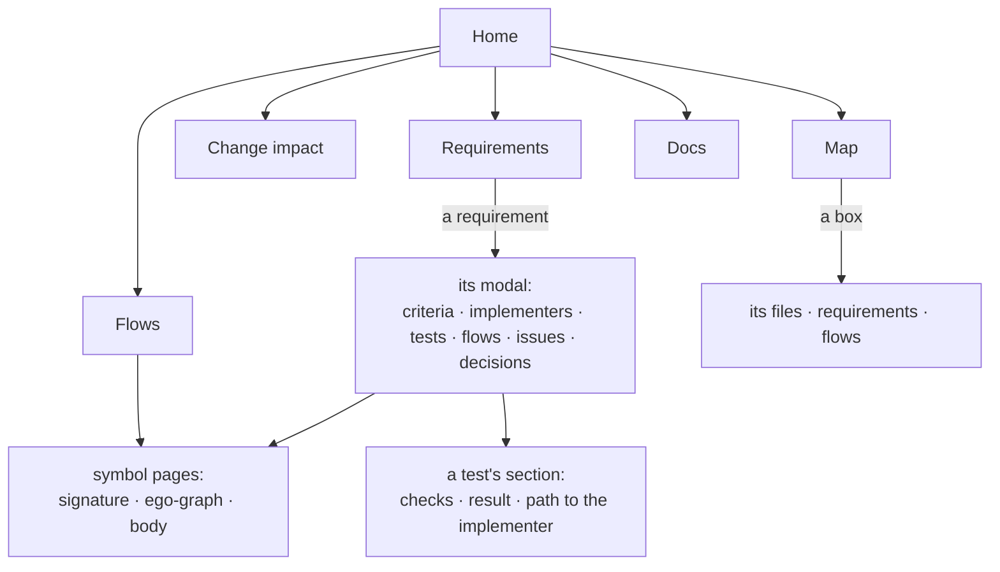
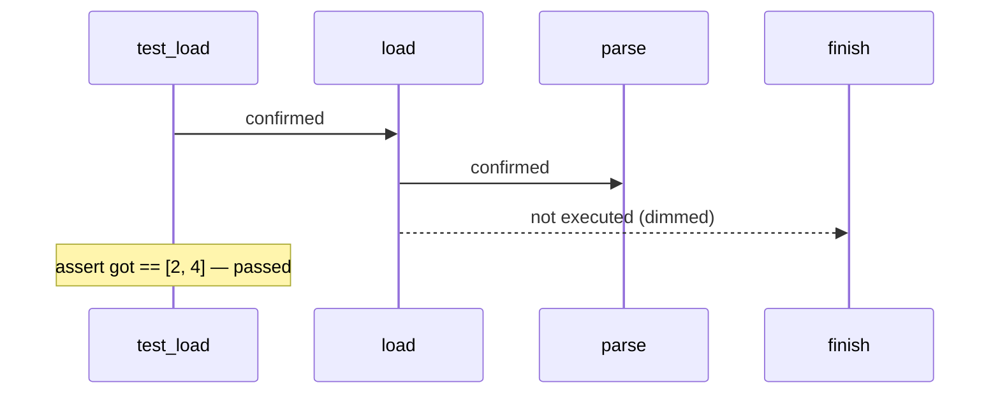

# clew wiki

A documentation site generated entirely from what the repository already has. Nothing is written
by hand for it: the index, the requirements catalog, test reports, `.clew.yaml` and the prose you
select become one site. It can be read three ways, from the same build.



## Open it

```bash
pip install 'clew-trace[wiki]'   # Sphinx + MyST — only the HTML site needs it
clew wiki open                    # the live hub if the MCP server runs one, else build + open files
```

In Claude Code the plugin's `/wiki` does the same. Set `CLEW_WIKI=1` in the MCP server's
environment to run the **hub**: one page listing every repository indexed on this machine, each
wiki built the first time it is opened, rebuilt when its index refreshes, and a "the agent is
looking here" link whenever a `dossier` reply names a function. It listens on 127.0.0.1 only,
behind a per-session token — see [SECURITY.md](SECURITY.md#9-the-wiki-hub-and-issue-fetching-reach-beyond-the-build).
Reading never needs a server: the built site is static files.

## What the site holds



| section | what it shows |
|---|---|
| **Requirements** | One card per requirement group (passing count, tier bar) that filters the list. Each requirement opens a modal: acceptance criteria, the functions implementing it, its tests and how each was linked, the flows it is on, open issues, the decisions that name it, and a prefilled "raise an issue" link. |
| **Product trace** | Shown when `wiki.catalogs` names pinned dependency catalogues. This repository's requirements as roots and, under each, the dependency requirements whose `satisfies` reaches it — transitively, every catalogue read at its pin. A dependency's functions and tests appear only when its index is at the pin (checkout at the pin, clean, index current); otherwise the row says **unknown** and why, with a link to the local checkout, or **absent** with no index. Dependency requirements this repository implements are listed apart; dangling links, double pins and unreached requirements are reported. `clew wiki check` reports the same problems. |
| **Flows** | A UML sequence diagram for every entry point and every root you declare, grouped by role — Product, Threads, Tooling, Tests. Every step is an index edge, badged with the requirements its callee implements; click one for the call it makes. Each flow is also exported as Mermaid and PlantUML. |
| **Change impact** | From clew-guard's `impact.json`: each changed function, the requirements it implements and the flows it is on. Without a report it says *not measured*. |
| **Map** | The system's components (callers above callees, arrows sized by calls) at two zooms — components, and every function as a point — re-tinted by lens: requirements, tests, and concurrency, change or issues when their sources exist. Pick a flow to watch it cross the components. A small copy of the map sits in every page's sidebar, lighting what that page touches. |
| **Docs** | Your prose grouped by kind (tutorial, how-to, reference, explanation), agent-facing documents apart, and the architecture decision records. |
| **Model entries** | Entries of declared model files and the functions that realise them (`@node`). |
| **Symbol pages** | A section per referenced function: signature, source link, a radial graph of its callers and callees two hops out, its requirements and flows, and its body. A test's section adds what it checks — its assertions, its result, the requirements it verifies and the call path to each implementer. Gherkin scenarios are shown as Gherkin. |

Everything works on a phone: the top bar folds into a menu, tables become cards, diagrams pan
and zoom.

## How a test is linked to a requirement

A test needs no tag. Links are made strongest first, and the site marks every link weaker than a
tag:

| kind | made by |
|---|---|
| tagged | `@req` on the test, a mapping file, or a Gherkin scenario tag |
| measured | per-test coverage ran a line of an implementer |
| catalog | the catalog's evidence field names the test's file |
| inferred | the test's calls reach an implementer within `infer_depth` hops |

| tier | meaning |
|---|---|
| PASS | a linked test passed and none failed |
| GAP | a linked test failed or errored |
| TARGET | every linked result is a skip of a target-only test |
| NOT_RUN | tests are linked but skipped, or no report holds their result |
| MISSING | no test is linked |

Unmeasured is never reported as a result: with no coverage report, coverage fields are absent.

## Watch a test run against the flow it should follow



```bash
clew wiki trace-run --test tests/test_m.py::test_load --out spans.json
```

The test runs in the repository's own interpreter under a tracer that records every call between
the repository's functions as OpenTelemetry spans, with the values passed and returned. The
overlay marks each step of the flow the index predicted as **confirmed** or **not executed**,
lists calls the run made that the flow did not predict as **discovered**, and shows each
assertion the test reached and where it failed. On the hub, a test's flow page offers the same
as a button when `CLEW_WIKI_RUN=1` is set (it executes the repository's code). For other
languages, export your test run's spans as OTLP JSON and list them under `wiki.tests.traces`: the
overlay is drawn into the static site.

## Publish it

| where | how |
|---|---|
| GitHub Pages | the composite action `tvanfossen/clew/.github/actions/wiki` builds the HTML site (version-keyed if you like); upload and deploy with your own Pages steps |
| GitHub wiki | `clew wiki build --format markdown --flavor github --out <wiki checkout>` |
| Azure DevOps wiki | `templates/azure-pipelines-wiki.yml` builds `--format markdown --flavor ado` and pushes it to a code wiki with the job's token |

The Markdown pages carry the requirements, flows (Mermaid) and change impact; the map, lenses and
call graphs are the HTML site's.

## Exports

Every HTML build also writes, obeying its audience: `llms.txt` and `llms-full.txt` at the site
root; `exports/requirements.reqif` (ReqIF 1.2), `exports/needs.json` (Sphinx-needs),
`exports/system.dsl` (Structurizr) and, per flow, `exports/flows/<flow>.mmd` / `.puml`. A
Sphinx-needs `needs.json` can also be imported (`wiki.needs`). The MCP server exposes the dense
text and each flow as resources, `clew://wiki/{slug}/llms.txt` and `clew://wiki/{slug}/flow/{name}`.

## Commands

```bash
clew wiki open                                  # one click: hub or built files
clew wiki check                                 # validate the wiki: section; no Sphinx
clew wiki build --out site                      # site/html
clew wiki build --out sites --version v1.2.0    # one site per release, with a burndown
clew wiki build --format markdown --flavor ado --out wiki
clew wiki diff --out sites v1.1.0 v1.2.0        # what changed between two recorded versions
clew wiki flow ENTRY --svg --animate            # one diagram, standalone
clew wiki trace --config .clew.yaml             # the graded trace as JSON
clew wiki trace-run --test NODE --out spans.json
```

`check` is cheap and belongs in pre-commit (the `clew-wiki-check` hook) or a CI static stage;
`build` is a separate stage. Both take `--refresh` to bring the index current first. The hook
passes `--before-tests`: test reports (JUnit, results, coverage, gcov) are what the test run
writes, so before it they are not yet required; run `check` without it after the tests, in CI.

## The `wiki:` section of `.clew.yaml`

Every key is known by name: a misspelled one is a problem, never ignored.

```yaml
wiki:
  title: Demo
  docs: [README.md, "docs/**/*.md"]
  doc_kinds: {README.md: tutorial, "docs/OVERVIEW.md": explanation}   # tutorial|howto|reference|explanation|agents
  adrs: ["docs/adr/*.md"]       # decision records (this is the default)
  entry_points: 2               # every console script / main / thread entry is a flow (0 = off)
  tooling: ["scripts/*", "tools/*"]   # entry points here are grouped as Tooling
  test_flows: 50                # how many directly linked tests are drawn as flows
  flows:                        # roots you choose, added to the entry points
    - entry: load               # bare name; `qualified:` or `file:` selects one identity
      depth: 3
      lanes: files              # files | packages | threads
      stop_at: [log]
      animate: true
      role: product             # product | threads | tooling | tests
  components:                   # the map's boxes; default = packages by path
    Query layer: ["src/query/*"]
  tests:
    junit: [build/junit.xml]
    results:                    # each DECLARED: ctest | tap | catch2 | pytest-json | ceedling | unity | ctrf
      - {format: ctest, path: build/Testing/Test.xml}
    coverage: build/coverage.xml          # Cobertura
    gcov: ["build/**/*.gcov", build/cov.json.gz]
    mapping: docs/req_tests.yaml          # {REQ: [test]} or a `req,test` CSV
    features: ["tests/features/**/*.feature"]      # Gherkin: @REQ-ID tags
    layers: {unit: ["tests/unit/*"], bdd: ["tests/features/*"]}
    min_layers: 2               # flag requirements tested in fewer layers
    target_only: ["test_hw_*"]  # skipped on host by design: TARGET, not a gap
    contexts: build/coverage.json         # coverage.py JSON with --cov-context=test
    evidence_fields: [x-evidence, evidence]
    infer_depth: 2              # link tests whose calls reach an implementer (0 = off)
    mutations: build/mutations.yaml
    traces: ["build/traces/*.json"]       # OTLP JSON test runs, drawn over their flows
  needs: docs/needs.json        # Sphinx-needs requirements (the catalog wins)
  issues: {github: owner/repo, fetch: true}  # or {ado: org/project}; false = no issue links
  sources:                      # model files whose entries code realises (@node)
    - {name: keys, path: model/keys.toml, items: keys, doc: doc}
  catalogs:                     # sub-catalogs read at a pinned commit
    - {name: kv, repo: ../kv, pin: "<sha>", catalog: requirements.yaml}
  rules:                        # external rules mapped onto requirements
    - {id: R1, title: "Timeouts are bounded", requirements: [REQ-NET-001]}
  links:
    template: "https://host/repo/blob/{commit}/{file}#L{line}"
  theme:
    name: clew                  # or any installed Sphinx theme
    palette: {acc: "#3D6B2E"}
    css: [docs/wiki.css]
    logo: docs/logo.svg
    fonts: true
  roadmap: ROADMAP.md           # headings naming a version are burndown milestones
  impact: docs/generated/impact/impact.json   # default: from the guard: section
  audiences:
    partner: {exclude_bodies: true, exclude_requirement_text: true}
```

`--audience NAME` applies an audience's redaction to every output, exports included:
`exclude_bodies` removes function bodies, call text and assertions; `exclude_requirement_text`
removes requirement titles and criteria. A source link is dropped when the repository has a
remote and no remote branch holds the commit it would name, so a published site never links a
404.

## Theme

The default theme is clew's own, in the sassafras-class look, with Manrope, Newsreader and
JetBrains Mono bundled under the SIL Open Font License. Palette tokens: `surface paper muted inset
ink ink2 faint rule rule2 acc accbg accink root rootbg err errbg warn warnbg`. Naming another
theme leaves that theme's look untouched.
