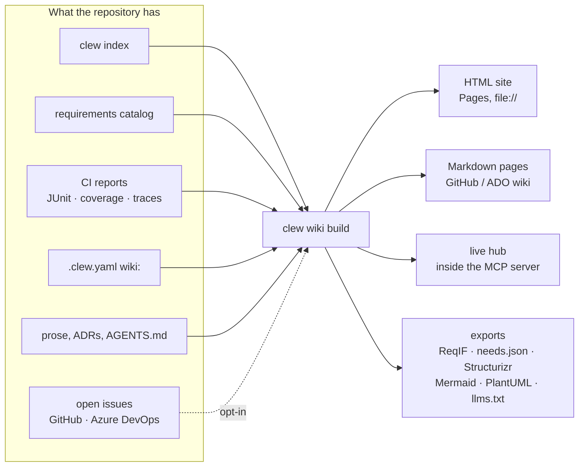
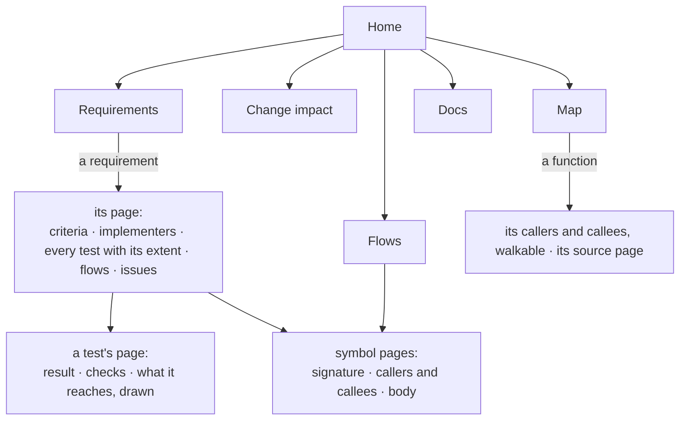
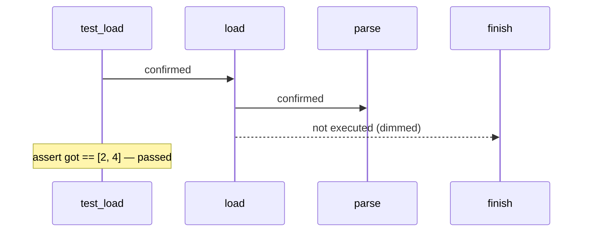

# clew wiki

A documentation site generated entirely from what the repository already has. Nothing is written
by hand for it: the index, the requirements catalog, test reports, `.clew.yaml` and the prose you
select become one site. It can be read three ways, from the same build.



## Open it

```bash
pip install 'clew-trace[wiki]'   # Sphinx + MyST — only the HTML site needs it
clew wiki open                    # the live hub if the MCP server runs one, else build + open files
```

In Claude Code the plugin's `/wiki` does the same. Set `CLEW_WIKI=1` in the MCP server's
environment to run the **hub**: one page listing every repository indexed on this machine, each
wiki built the first time it is opened, rebuilt when its index refreshes, and a "the agent is
looking here" link whenever a `dossier` reply names a function. It listens on 127.0.0.1 only,
behind a per-session token — see [SECURITY.md](SECURITY.md#9-the-wiki-hub-and-issue-fetching-reach-beyond-the-build).
Reading never needs a server: the built site is static files.

## What the site holds



| section | what it shows |
|---|---|
| **Requirements** | One card per requirement group (passing count, tier bar) that filters the list. Each requirement has its own page: acceptance criteria, the functions implementing it, every test in two tables — linked directly, and reached through calls — with its result, how it was linked, which implementers it exercises ("2 of 9") and how many calls away it is, the flows it is on, open issues, the decisions that name it, and a prefilled "raise an issue" link. |
| **Product trace** | Shown when `requirements.external` names pinned dependency catalogues. This repository's requirements as roots and, under each, the dependency requirements whose `satisfies` reaches it — transitively, every catalogue read at its pin. A dependency's functions and tests appear only when its index is at the pin (checkout at the pin, clean, index current); otherwise the row says **unknown** and why, with a link to the local checkout, or **absent** with no index. Dependency requirements this repository implements are listed apart; dangling links, double pins and unreached requirements are reported. `clew wiki check` reports the same problems. |
| **Flows** | A UML sequence diagram for every entry point and every root you declare, grouped by role — Product, Threads, Tooling, Tests. Every step is an index edge, badged with the requirements its callee implements; click one for the call it makes. Each flow is also exported as Mermaid and PlantUML. |
| **Change impact** | From clew-guard's `impact.json`: each changed function, the requirements it implements and the flows it is on. Without a report it says *not measured*. |
| **Map** | The repository web: every function in one zoomable view. Each wedge is a block of the system (declared in `wiki.components`; an undeclared file joins the block it shares the most calls with, and is listed as placed by coupling; an undeclared file inside a submodule the repository declares is the **Vendor** block, never folded into first-party code); rings run outward by call depth from the entry points. Zoomed out you see the blocks and the calls between them; zoom in and the functions appear. Click a function to see what it calls and what calls it and walk from there; search jumps the camera to a name; pick a flow to watch it travel. The same blocks are listed as a table below. Every page's sidebar lists the blocks, labelled, lighting the ones that page touches. |
| **Docs** | Your prose grouped by kind (tutorial, how-to, reference, explanation), agent-facing documents apart, and the architecture decision records. |
| **Model entries** | Some behaviour is defined by data — a key table, a command list, shipped models. Declare those files in `wiki.sources`; a function that implements a row says so with `@node <source>:<id>`. The page shows each row, the code realising it and the requirement it serves, with a count per source. It is built only when some function realises a row. |
| **Test pages** | One per test: the packaged run's result (a failure's message in red), the checks it makes, and a drawing of what it reaches — from the test, through its calls, to each requirement's implementer. Reaching is not proving: without mutation records the page says what the test reaches; with them, which breaks it caught. |
| **Symbol pages** | A section per referenced function: signature, source link, its callers and callees (each linked), a link to it on the map, its requirements and flows, and its body. Gherkin scenarios are shown as Gherkin. |

Everything works on a phone: the top bar folds into a menu, tables become cards, diagrams pan
and zoom.

## How a test is linked to a requirement

A test needs no tag. Links are made strongest first, and the site marks every link weaker than a
tag:

| kind | made by |
|---|---|
| tagged | `@req` on the test, a mapping file, or a Gherkin scenario tag |
| measured | per-test coverage ran a line of an implementer |
| catalog | the catalog's evidence field names the test's file |
| inferred | the test's calls reach an implementer, at any depth (`infer_depth` caps it; 0 turns it off) |

Every measured or inferred link carries its **extent** — which of the requirement's implementers
the test executes or reaches — and an inferred one its distance in calls, so a test aimed at a
requirement lists before one that passes through it on the way elsewhere. A function in test code
is never counted as an implementer. With Python, running the tests with `--cov-context=test` and naming coverage's data file
(`contexts: .coverage`) gives measured links, including calls a static graph cannot see (a tool
called by name). A JSON report with contexts works too, but grows with tests × lines — 3.9 GB on
clew's own suite.

For C and C++ the repository produces its own per-test report and names it the same way
(`contexts: build/per-test.info`): an LCOV tracefile with one `TN:` section per test, named as the
test's result is named. clew reads it and never runs your build. One way, with gcov under ctest
(built with `--coverage`; checked with gcc and gcovr 8.8 on a two-test project whose test names hold
spaces and regex characters):

```bash
# one test at a time: clear the counters, run it, export its lines under its own TN: name
# (a read loop, because Catch2 test names hold spaces; -R is a regex, so escape its specials)
ctest --test-dir build -N | sed -n 's/^ *Test *#[0-9]*: //p' | while IFS= read -r t; do
  find build -name '*.gcda' -delete
  ctest --test-dir build -R "^$(printf '%s' "$t" | sed 's/[][\.*^$()+?{}|]/\\&/g')\$"
  gcovr --root . --lcov - | sed "s|^TN:.*|TN:$t|" >> build/per-test.info
done
```

| tier | meaning |
|---|---|
| PASS | a linked test passed and none failed |
| GAP | a linked test failed or errored |
| TARGET | every linked result is a skip of a target-only test |
| NOT_RUN | tests are linked but skipped, or no report holds their result |
| MISSING | no test is linked |
| EXEMPT | no test is linked, and the catalog's status is one `requirements.exempt_status` exempts (as `clew guard coverage` does) |

Unmeasured is never reported as a result: with no coverage report, coverage fields are absent.

## Watch a test run against the flow it should follow



```bash
clew wiki trace-run --test tests/test_m.py::test_load --out spans.json
```

The test runs in the repository's own interpreter under a tracer that records every call between
the repository's functions as OpenTelemetry spans, with the values passed and returned. The
overlay marks each step of the flow the index predicted as **confirmed** or **not executed**,
lists calls the run made that the flow did not predict as **discovered**, and shows each
assertion the test reached and where it failed. On the hub, a test's flow page offers the same
as a button when `CLEW_WIKI_RUN=1` is set (it executes the repository's code). For other
languages, export your test run's spans as OTLP JSON and list them under `tests.traces`: the
overlay is drawn into the static site.

## Publish it

| where | how |
|---|---|
| GitHub Pages | the composite action `tvanfossen/clew/.github/actions/wiki` builds the HTML site (version-keyed if you like); upload and deploy with your own Pages steps |
| GitHub wiki | `clew wiki build --format markdown --flavor github --out <wiki checkout>` |
| Azure DevOps wiki | `templates/azure-pipelines-wiki.yml` builds `--format markdown --flavor ado` and pushes it to a code wiki with the job's token |

The Markdown pages carry the requirements, flows (Mermaid) and change impact; the map, lenses and
call graphs are the HTML site's.

## Exports

Every HTML build also writes, obeying its audience: `llms.txt` and `llms-full.txt` at the site
root; `exports/requirements.reqif` (ReqIF 1.2), `exports/needs.json` (Sphinx-needs),
`exports/system.dsl` (Structurizr) and, per flow, `exports/flows/<flow>.mmd` / `.puml`. A
Sphinx-needs `needs.json` can also be imported (`requirements.needs`). The MCP server exposes the dense
text and each flow as resources, `clew://wiki/{slug}/llms.txt` and `clew://wiki/{slug}/flow/{name}`.

## Commands

```bash
clew wiki open                                  # one click: hub or built files
clew wiki check                                 # validate the wiki: section; no Sphinx
clew wiki build --out site                      # site/html
clew wiki build --out sites --version v1.2.0    # one site per release, with a burndown
clew wiki build --format markdown --flavor ado --out wiki
clew wiki diff --out sites v1.1.0 v1.2.0        # what changed between two recorded versions
clew wiki flow ENTRY --svg --animate            # one diagram, standalone
clew wiki trace --config .clew.yaml             # the graded trace as JSON
clew wiki trace-run --test NODE --out spans.json
```

`check` is cheap and belongs in pre-commit (the `clew-wiki-check` hook) or a CI static stage;
`build` is a separate stage. Both take `--refresh` to bring the index current first. The hook
passes `--before-tests`: test reports (JUnit, results, coverage, gcov) are what the test run
writes, so before it they are not yet required; run `check` without it after the tests, in CI.

## The `wiki:` section of `.clew.yaml`

Every key is known by name: a misspelled one is a problem, never ignored. The catalog, its
pinned sub-catalogues (`external`) and a Sphinx-needs import (`needs`) are the top-level
`requirements:` section the gate and the index read too (docs/GUARD.md); the change-impact report
is read from the gate's `guard.impact.report_dir`.

```yaml
requirements:
  file: docs/requirements.yaml
  needs: docs/needs.json        # Sphinx-needs requirements (the catalog wins)
  external:                     # sub-catalogs read at a pinned commit
    - {repo: ../kv, rev: "<sha>", path: requirements.yaml, name: kv}
```

```yaml
tests:                          # top level: the index and the wiki read it
  paths: ["tests/*", "*_test.cpp"]   # where test code lives (the index's test scope)
  junit: [build/junit.xml]
  results:                    # each DECLARED: ctest | tap | catch2 | pytest-json | ceedling | unity | ctrf
    - {format: ctest, path: build/Testing/Test.xml}
  coverage: build/coverage.xml          # Cobertura
  gcov: ["build/**/*.gcov", build/cov.json.gz]
  mapping: docs/req_tests.yaml          # {REQ: [test]} or a `req,test` CSV
  features: ["tests/features/**/*.feature"]      # Gherkin: @REQ-ID tags
  layers: {unit: ["tests/unit/*"], bdd: ["tests/features/*"]}
  min_layers: 2               # flag requirements tested in fewer layers
  target_only: ["test_hw_*"]  # skipped on host by design: TARGET, not a gap
  contexts: .coverage                   # coverage.py data/JSON (--cov-context=test), or LCOV with TN: per test
  evidence_fields: [x-evidence, evidence]
  infer_depth: 4              # cap call-graph links at N calls (omit = any depth; 0 = off)
  mutations: build/mutations.yaml
  traces: ["build/traces/*.json"]       # OTLP JSON test runs, drawn over their flows
```

```yaml
wiki:
  title: Demo
  docs: [README.md, "docs/**/*.md"]
  doc_kinds: {README.md: tutorial, "docs/OVERVIEW.md": explanation}   # tutorial|howto|reference|explanation|agents
  adrs: ["docs/adr/*.md"]       # decision records (this is the default)
  entry_point_depth: 2          # every console script / main / thread entry is a flow this deep (0 = off)
  tooling: ["scripts/*", "tools/*"]   # entry points here are grouped as Tooling
  flows:                        # roots you choose, added to the entry points
    - entry: load               # bare name; `qualified:` or `file:` selects one identity
      depth: 3
      lanes: files              # files | packages | threads
      stop_at: [log]
      animate: true
      role: product             # product | threads | tooling | tests
  components:                   # the map's blocks; undeclared files join by coupling, submodules are Vendor; default = packages
    Query layer: ["src/query/*"]
  issues: {github: owner/repo, fetch: true}  # or {ado: org/project}; false = no issue links
  sources:                      # model files whose entries code realises (@node)
    - {name: keys, path: model/keys.toml, items: keys, doc: doc}
  rules:                        # external rules mapped onto requirements
    - {id: R1, title: "Timeouts are bounded", requirements: [REQ-NET-001]}
  links:
    template: "https://host/repo/blob/{commit}/{file}#L{line}"
  theme:
    name: clew                  # or any installed Sphinx theme
    palette: {accent: "#3D6B2E"}
    css: [docs/wiki.css]
    logo: docs/logo.svg
    fonts: true
  roadmap: ROADMAP.md           # headings naming a version are burndown milestones
  audiences:
    partner: {exclude_bodies: true, exclude_requirement_text: true}
```

`--audience NAME` applies an audience's redaction to every output, exports included:
`exclude_bodies` removes function bodies, call text and assertions; `exclude_requirement_text`
removes requirement titles and criteria. A source link is dropped when the repository has a
remote and no remote branch holds the commit it would name, so a published site never links a
404.

## Theme

The default theme is clew's own, in the sassafras-class look, with Manrope, Newsreader and
JetBrains Mono bundled under the SIL Open Font License. Palette tokens: `surface paper muted inset
ink ink_soft faint rule rule_strong accent accent_bg accent_ink root root_bg error error_bg warning
warning_bg` (2.0.0 renamed the abbreviations — `acc`, `accbg`, `rule2`, … — and names each old one
with its replacement). Naming another
theme leaves that theme's look untouched.
